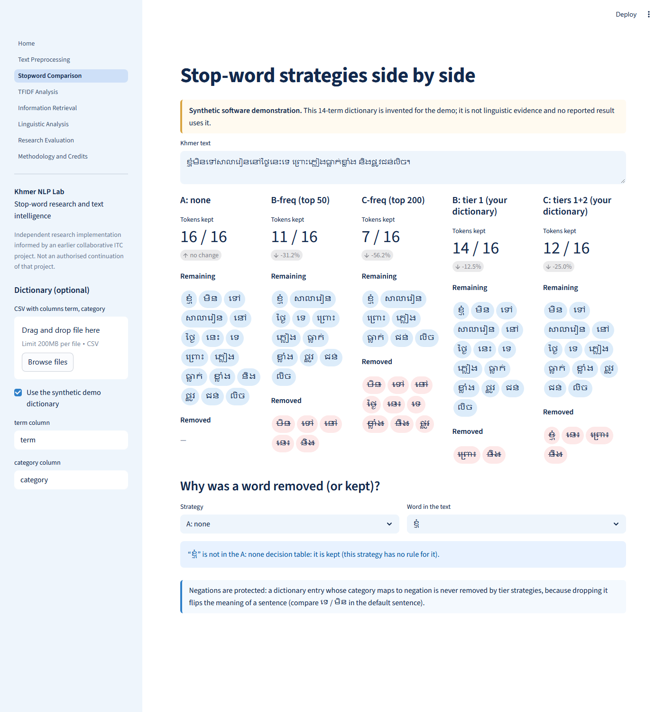
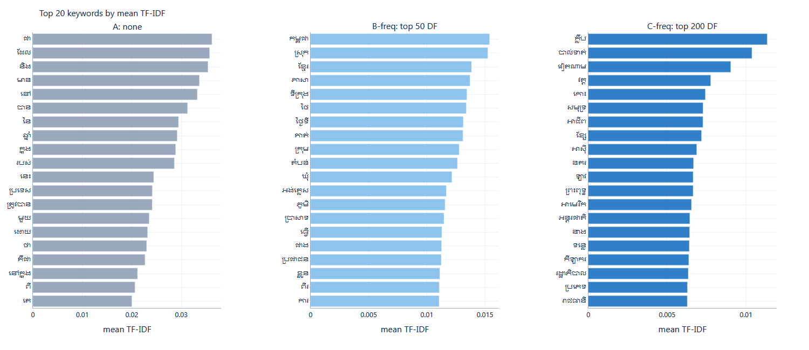
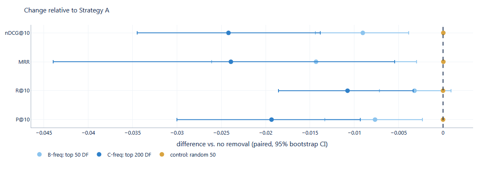

# Khmer NLP Research — stop-word strategies, TF-IDF and exploratory retrieval

**Status: research prototype, v0.1.0, not yet published.** An independent research implementation, informed by an earlier
collaborative university project at the Institute of Technology of Cambodia (ITC):
[Nagamiji/Stop_word_Project](https://github.com/Nagamiji/Stop_word_Project). It is **not** an authorised continuation of that
project and contains none of its code, dictionaries, corpus, tables or results (that repository has no licence and permission has not
been obtained). See [team contributions](docs/team_contributions.md) and the [audit](docs/upstream_audit.md).



## Research background and problem

Khmer is written without word spaces and its function words (particles, prepositions, conjunctions, negations …) are very
frequent. Whether removing them helps downstream tasks, which categories are safe to remove, and how far a fixed list can be
trusted are open empirical questions. The audit of the earlier project found claims its own recorded results did not support
(for example, a retrieval benefit that its known-item test, which has the query document inside the index, cannot show). This
project rebuilds the experimental infrastructure with held-out queries, controls, uncertainty and honest labelling.

**Research questions.** RQ1 effect on preprocessing · RQ2 effect on TF-IDF representation · RQ3 *(exploratory)* effect on retrieval,
measured with category-derived proxy labels · RQ4 which linguistic categories to remove/keep (**not answerable here**: needs a
validated, categorised dictionary) · RQ5 limits of fixed lists.

## What was built

| Component | Where | Notes |
|---|---|---|
| Normalisation | `src/khmer_nlp/normalization` | NFC, invisible characters, zero-width space, whitespace; raw text kept |
| Tokenisation | `src/khmer_nlp/tokenization` | `khmer-nltk` 1.6, character-cluster baseline, whitespace; duplicate detection; boundary-F1 between tokenizers |
| Dictionary import and validation | `src/khmer_nlp/stopwords` | any CSV; reports raw/unique/normalised counts, duplicates, empty, padded, multi-word, conflicting labels |
| Strategies A / B / C | same | A none; B tier 1; C tiers 1+2; negations, question words, discourse markers protected; decision table per word |
| Statistical stop lists | same | B-freq (top 50 by document frequency), C-freq (top 200), random-50 control |
| TF-IDF | `src/khmer_nlp/tfidf` | written out explicitly, verified against scikit-learn |
| Retrieval and protocol | `src/khmer_nlp/retrieval`, `evaluation` | held-out queries, leakage assertion, near-duplicate filter, P@5/10, R@5/10, MRR, nDCG@10, mean relevant rank, bootstrap CIs |
| Linguistic analysis | `src/khmer_nlp/linguistic_analysis` | removal profile, category contribution, protected words kept, potential false removals (mutual information) |
| App | `app/` | 8 pages, white / light-blue / navy |
| Tests | `tests/` | pytest with synthetic fixtures, no network |

### The dictionary question
No categorised Khmer stop-word dictionary is bundled or used. Tier strategies B and C are implemented and tested on synthetic
fixtures but **have not been run on research data**; the public experiments use statistical (frequency-based) lists. Bring your own
dictionary: `python scripts/run_experiments.py --dictionary my.csv --term-col term --category-col category`, or upload it in the
app. [`data/samples/synthetic_demo_dictionary.csv`](data/samples/README.md) is a 14-term software demo, not research data.
Audited facts about the original files (counts only): the broad-class file has **510** entries (511 lines with its header, not 511 words);
the master file has 770 rows, 726 unique normalised entries, 44 duplicates, 22 terms with conflicting category labels, and rows labelled
"Phrase" and "Content word" that need linguistic review.

## Data

Khmer Wikipedia lead sections (CC BY-SA 4.0 as reported by the site), downloaded on 2026-10-31 by
`scripts/download_wikipedia.py` with revision ids and history URLs in [`data/manifest`](data/manifest). 14,701 non-redirect articles listed;
after filtering (lead ≥ 200 characters, ≥ 50 % Khmer script) **8,806 articles, 2,141,077 tokens, 96,338 distinct terms**; 3,698 articles
carry at least one topical category (2,943 distinct). The text is not committed. See the [dataset card](docs/dataset_card.md). Licences are separate:
software MIT, Wikipedia text CC BY-SA 4.0.

## Experimental design (all values fixed in `configs/experiment.yaml` before results were inspected; seed 42)

1. **TF-IDF comparison** on identical documents, tokenizer and TF-IDF settings for every strategy.
2. **Retrieval, proxy labels.** 300 query articles are held out of the index; the query is their first 40 tokens; an indexed article is
   "relevant" if it shares a usable (5–60 members) Wikipedia category with the query article. Stop lists and IDF are learned from indexed
   documents only. This is **not** human judgement; see limitations.
3. **Known-item retrieval** (query document in the index): sanity check only.
4. **Classification**: TF-IDF + Linear SVC predicting the Wikipedia category, 5-fold CV, preprocessing learned in-fold.
5. **Controls**: a random-50 stop list of the same size as B-freq.

## Results (from executed runs; tables in `reports/experiments/`)

**TF-IDF (RQ2).**

| Strategy | Tokens removed | Vocabulary | Share of tokens in 10 commonest terms |
|---|---|---|---|
| A none | 0 % | 96,338 | 0.139 |
| B-freq top 50 | 29.9 % | 96,288 | 0.035 |
| C-freq top 200 | 46.8 % | 96,138 | 0.026 |
| control random 50 | 0.4 % | 96,288 | 0.139 |

Removal deletes many tokens but almost no vocabulary: it changes the *concentration* of the distribution (the dominant terms vanish),
which is not evidence of better downstream performance. Without removal, the top-20 keywords by mean TF-IDF are dominated by
function words; with removal, content words appear ([figure](reports/figures/top20_keywords.png)).



**Exploratory retrieval with proxy labels (RQ3).** 300 queries, 8,506 indexed articles, 379 usable categories, median 17 relevant
articles per query, 0 queries dropped by the near-duplicate filter.

| Strategy | nDCG@10 | difference vs A (paired 95 % bootstrap CI) | MRR | P@10 |
|---|---|---|---|---|
| A none | 0.351 | – | 0.559 | 0.292 |
| B-freq top 50 | 0.342 | −0.009 [−0.014, −0.004] | 0.545 | 0.285 |
| C-freq top 200 | 0.327 | −0.024 [−0.035, −0.014] | 0.535 | 0.273 |
| control random 50 | 0.351 | 0.000 | 0.559 | 0.292 |

In this sample, removing the most frequent terms **slightly lowered** proxy-retrieval scores, in the same direction for all five query
samples (seeds 42, 1–4), while an equal-size random removal changed nothing. We did not test why; a plausible but untested
explanation is that TF-IDF already down-weights frequent terms and short queries lose matching terms. These numbers do **not** show that
stop-word removal improves or harms real-world search, and they say nothing about linguistically categorised lists.



**Known-item sanity check.** Mean rank of the target is 1.11 (first 40 tokens) and 1.00 (full document) for every strategy: the
document matches itself. This cannot measure retrieval quality.

**Classification.** 796 articles, 12 classes, majority-class accuracy 0.276. Macro-F1 (mean ± sd over folds): A 0.754 ± 0.036,
B-freq 0.769 ± 0.060, C-freq 0.749 ± 0.064, control 0.753 ± 0.035. Differences are within fold-to-fold variation; the experiment does
not rank the strategies.

**Tokenizer versions (RQ1).** On 200 lead sections, `khmer-nltk` 1.2–1.6 produced identical segmentations; 1.0 and 1.1 produced about 5×
more tokens with boundary-F1 0.32 against 1.6 ([`reports/tokenizer_versions.md`](reports/tokenizer_versions.md)). Pin the version.

**Linguistic analysis (RQ4, RQ5).** The statistical lists contain no linguistic categories, so they cannot say which categories to remove.
The app lists the most-removed words, potential false removals (removed terms most informative about the class label) and, with an
imported dictionary, category contribution and protected words kept.

## Install and use

```
python -m venv .venv && .venv\Scripts\activate
pip install -r requirements.txt
pip install -e . --no-deps                      # makes the khmer_nlp package importable by the scripts
python scripts/download_wikipedia.py            # about 15 min, resumable
python scripts/run_experiments.py --retokenize  # about 5 min
python scripts/render_figures.py                # optional, needs Microsoft Edge
streamlit run app/Home.py                       # binds to 127.0.0.1 only
pytest && ruff check .
```

## Limitations (full list: [docs/limitations.md](docs/limitations.md))

Proxy labels from categories are noisy and are not human judgements · public stop lists are statistical, not linguistic · tier strategies
untested on research data · Wikipedia lead sections only · one tokenizer version · classification is near a ceiling and uninformative
for ranking · GitHub Actions has never run for this repository · tested on Python 3.12 only.

## Future work

[`docs/NEXT_STEPS.md`](docs/NEXT_STEPS.md): permission and a validated dictionary, human-judged relevance, linguistic validation, further
tokenizers, Unicode reordering, context-aware removal, transformer and neural retrieval baselines.

## Credits and references

Original ITC project and its contributors: see [docs/team_contributions.md](docs/team_contributions.md) (roles pending confirmation). Author of this
repository: Thy Chantha, student team member and technical contributor to the original project.

References (DOIs checked against Crossref): Salton, Wong & Yang (1975) doi:10.1145/361219.361220 · Spärck Jones (1972) doi:10.1108/eb026526 ·
Salton & Buckley (1988) doi:10.1016/0306-4573(88)90021-0 · Järvelin & Kekäläinen (2002) doi:10.1145/582415.582418 · Joachims (1998)
doi:10.1007/bfb0026683 · Efron (1979) doi:10.1214/aos/1176344552 · khmer-nltk (Apache-2.0 per PyPI) · Wikipedia text under
[CC BY-SA 4.0](https://creativecommons.org/licenses/by-sa/4.0/).
